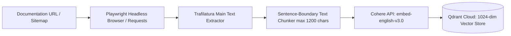
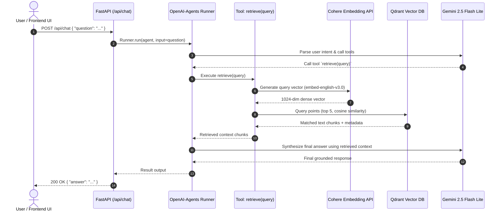

# 📚 Intelligent RAG Chatbot Backend

[](https://www.python.org/)
[](https://fastapi.tiangolo.com/)
[](https://cohere.com/)
[](https://qdrant.tech/)
[](https://deepmind.google/technologies/gemini/)
[](https://github.com/astral-sh/uv)
[](LICENSE)

An enterprise-grade, high-performance **Retrieval-Augmented Generation (RAG) backend** service and autonomous web ingestion engine. Designed specifically for interactive technical documentation, textbook tutoring, and domain knowledge assistants, this system pairs **Cohere** semantic embeddings and **Qdrant Cloud** vector search with **Google Gemini 2.5 Flash Lite** orchestrated by the modern **`openai-agents`** framework.

---

## 📑 Table of Contents

- [Overview](#-overview)
- [System Architecture](#-system-architecture)
  - [1. Data Ingestion & Vector Indexing Pipeline](#1-data-ingestion--vector-indexing-pipeline)
  - [2. Real-Time Agentic RAG Chat Flow](#2-real-time-agentic-rag-chat-flow)
- [Key Features](#-key-features)
- [Tech Stack](#-tech-stack)
- [Repository Structure](#-repository-structure)
- [Prerequisites](#-prerequisites)
- [Installation & Setup](#-installation--setup)
- [Environment Configuration](#-environment-configuration)
- [Data Ingestion Guide](#-data-ingestion-guide)
- [Running the API Server](#-running-the-api-server)
- [API Documentation](#-api-documentation)
  - [Endpoints](#endpoints)
  - [Example Requests & Responses](#example-requests--responses)
- [Frontend Integration Example](#-frontend-integration-example)
- [Roadmap & Enhancements](#-roadmap--enhancements)
- [Contributing & License](#-contributing--license)

---

## 🌟 Overview

Navigating dense technical textbooks and documentation sites often overwhelms learners. This RAG backend empowers users to chat naturally with web-based textbooks and documentation. 

The project incorporates:
1. **Automated Content Scrapers**: Scrapes dynamically rendered Single Page Applications (SPAs) or sitemaps using headless browser automation (**Playwright**) and semantic content extractors (**Trafilatura**).
2. **Dense Vector Embeddings**: Generates state-of-the-art 1024-dimensional semantic embeddings using Cohere's `embed-english-v3.0`.
3. **Managed Vector Store**: Indexes chunks and metadata into **Qdrant Cloud** for sub-millisecond approximate nearest neighbor (ANN) retrieval using Cosine similarity.
4. **Agentic RAG Engine**: Employs an autonomous agent with dynamic tool execution (`retrieve`), grounding its responses strictly in verified documentation context via **Google Gemini 2.5 Flash Lite**.
5. **High-Throughput REST API**: Provides low-latency asynchronous API endpoints powered by **FastAPI** with Cross-Origin Resource Sharing (CORS) preconfigured.

---

## 🏗️ System Architecture

### 1. Data Ingestion & Vector Indexing Pipeline



### 2. Real-Time Agentic RAG Chat Flow



---

## 🚀 Key Features

- **Agentic Tool-Calling Workflow**: Uses the `openai-agents` framework with function calling (`@function_tool`). The agent intelligently queries the vector store to formulate accurate answers.
- **Strict Anti-Hallucination Guardrails**: The agent prompt enforces answering strictly from retrieved book content, preventing unauthorized external facts or hallucinated information.
- **Headless JavaScript Scraping (Playwright)**: Captures client-rendered documentation (e.g., Docusaurus, Next.js, Starlight, GitBook) that regular HTTP clients cannot scrape.
- **Smart Sentence Boundary Chunking**: Splits text up to 1200 characters while preserving full sentences at natural period boundaries, preventing fragmented knowledge.
- **Cohere 1024-Dimension Embeddings**: Leverages `embed-english-v3.0` designed specifically for retrieval tasks with high semantic fidelity.
- **Qdrant Cloud Integration**: Cloud-native vector search engine with payload filtering, cosine distance measurement, and instant index updates.
- **FastAPI Asynchronous Backend**: Fully asynchronous endpoints (`async/await`) offering high concurrency, interactive OpenAPI docs (`/docs`), and health checks.
- **Cross-Origin Resource Sharing (CORS)**: Preconfigured middleware for seamless connection to modern frontends (React, Next.js, Vue, mobile apps).

---

## 🛠️ Tech Stack

| Layer | Component | Details |
| :--- | :--- | :--- |
| **Language** | Python | 3.12+ |
| **Web Framework** | [FastAPI](https://fastapi.tiangolo.com/) | Asynchronous web framework with Pydantic v2 validation |
| **ASGI Server** | [Uvicorn](https://www.uvicorn.org/) | High-speed lightning ASGI server |
| **Agent Orchestration** | [openai-agents](https://github.com/openai/openai-agents-python) | Agentic framework managing tool execution and LLM runner |
| **LLM Inference** | [Google Gemini 2.5 Flash Lite](https://deepmind.google/technologies/gemini/) | Fast, cost-efficient generative reasoning via OpenAI-compatible API |
| **Vector Embeddings** | [Cohere AI](https://cohere.com/) | `embed-english-v3.0` (1024 dimensions) |
| **Vector Database** | [Qdrant Cloud](https://qdrant.tech/) | Cloud-hosted vector similarity search engine |
| **Scraping & Parsing** | [Playwright](https://playwright.dev/) & [Trafilatura](https://trafilatura.readthedocs.io/) | Headless browser execution and clean main-body text extraction |
| **Package Management** | [uv](https://github.com/astral-sh/uv) / pip | Fast package resolution and installation |

---

## 📁 Repository Structure

```plaintext
chatbot-hackathon-backend/
├── .env.example              # Template for environment configuration
├── .gitignore                # Git ignore rules for Python, venv, and secrets
├── .python-version           # Recommended Python version (3.12)
├── pyproject.toml            # Project metadata, dependencies, and packaging specs
├── uv.lock                   # Deterministic lockfile for reproducible builds
├── main.py                   # Sitemap-driven ingestion pipeline (XML parsing)
└── src/
    └── rag_chatbot/
        ├── __init__.py       # Package initializer
        ├── api.py            # FastAPI application with Agent & RAG tool
        └── main.py           # Playwright headless browser crawler & Qdrant indexer
```

---

## 📋 Prerequisites

Before getting started, make sure you have the following installed:

1. **Python 3.12+**: Ensure Python is available on your system path.
2. **uv** *(recommended)* or **pip**: For dependency management.
3. **API Keys & Accounts**:
   - [Google AI Studio](https://aistudio.google.com/): To obtain a `GEMINI_API_KEY`.
   - [Cohere Dashboard](https://dashboard.cohere.com/): To obtain a `COHERE_API_KEY`.
   - [Qdrant Cloud](https://cloud.qdrant.io/): To obtain `QDRANT_URL` and `QDRANT_API_KEY`.

---

## ⚙️ Installation & Setup

### 1. Clone the Repository

```bash
git clone https://github.com/Wajid-Ali124/chatbot-hackathon-backend.git
cd chatbot-hackathon-backend
```

### 2. Set Up a Virtual Environment

**Using `uv` (Recommended):**
```bash
# Create virtual environment
uv venv

# Activate virtual environment
# On Windows:
.venv\Scripts\activate
# On Linux / macOS:
source .venv/bin/activate
```

**Using standard `python -m venv`:**
```bash
python -m venv .venv

# On Windows:
.venv\Scripts\activate
# On Linux / macOS:
source .venv/bin/activate
```

### 3. Install Dependencies

**Using `uv`:**
```bash
uv pip install -e .
```

**Using `pip`:**
```bash
pip install -e .
```

### 4. Install Playwright Browsers

The headless crawler uses Playwright Chromium:
```bash
playwright install chromium
```

---

## 🔐 Environment Configuration

Create a `.env` file in the root directory by copying the provided `.env.example`:

```bash
# On Windows PowerShell:
Copy-Item .env.example .env

# On Linux / macOS / Bash:
cp .env.example .env
```

Populate `.env` with your credentials:

```ini
# Google Gemini API Key
GEMINI_API_KEY=your_gemini_api_key_here

# Cohere API Key
COHERE_API_KEY=your_cohere_api_key_here

# Qdrant Vector Database
QDRANT_URL=https://xxxxxxxx-xxxx-xxxx-xxxx-xxxxxxxxxxxx.us-east4-0.gcp.cloud.qdrant.io:6333
QDRANT_API_KEY=your_qdrant_api_key_here

# Optional Settings
COLLECTION_NAME=ai-powered-book
PORT=8000
HOST=0.0.0.0
```

> [!WARNING]
> Never commit your `.env` file or raw API keys to public repositories. Make sure `.env` is listed in `.gitignore`.

---

## 📥 Data Ingestion Guide

The backend provides two flexible data ingestion pipelines:

### Method A: Playwright Dynamic Web Ingestion (Recommended for SPAs)

Best for JavaScript-rendered Single Page Applications (Next.js, Docusaurus, React):

1. Edit the target page URLs in `src/rag_chatbot/main.py`:
   ```python
   urls = [
       "https://your-textbook-site.com/docs/intro",
       "https://your-textbook-site.com/docs/chapter1",
       "https://your-textbook-site.com/docs/chapter2"
   ]
   ```
2. Run the ingestion script:
   ```bash
   python -m src.rag_chatbot.main
   ```
   **Execution stages:**
   - Launches headless Chromium via Playwright.
   - Extracts page DOM and filters out boilerplate via Trafilatura.
   - Creates/re-creates the Qdrant collection with 1024-dimensional Cosine vectors.
   - Chunks text at sentence boundaries.
   - Generates embeddings with Cohere `embed-english-v3.0`.
   - Upserts vectors and metadata payloads into Qdrant.

### Method B: Sitemap XML Crawler

Best for large static documentation deployments with an existing `sitemap.xml`:

1. Update `SITEMAP_URL` in `main.py`:
   ```python
   SITEMAP_URL = "https://your-deployed-site.vercel.app/sitemap.xml"
   COLLECTION_NAME = "humanoid_ai_book"
   ```
2. Run the sitemap ingestion:
   ```bash
   python main.py
   ```

---

## 🚀 Running the API Server

Start the FastAPI application with Uvicorn:

### Development Mode (with hot reload)

```bash
uvicorn src.rag_chatbot.api:app --reload --host 0.0.0.0 --port 8000
```

### Production Mode

```bash
uvicorn src.rag_chatbot.api:app --host 0.0.0.0 --port 8000 --workers 4
```

Once running:
- **API Base URL**: `http://localhost:8000`
- **Interactive Swagger Documentation**: `http://localhost:8000/docs`
- **ReDoc Documentation**: `http://localhost:8000/redoc`
- **Health Check Endpoint**: `http://localhost:8000/health`

---

## 📡 API Documentation

### Endpoints

#### 1. `GET /health`
Verifies that the server is operational.

- **Response `200 OK`**:
  ```json
  {
    "status": "healthy"
  }
  ```

---

#### 2. `POST /api/chat`
Submits a user query to the RAG Agent.

- **Headers**:
  ```http
  Content-Type: application/json
  ```
- **Request Body**:
  ```json
  {
    "question": "What are the fundamental components of a humanoid robot?"
  }
  ```
- **Response `200 OK`**:
  ```json
  {
    "answer": "Based on the textbook, humanoid robots consist of three primary components: actuators for movement, sensors for environmental perception, and a central controller for real-time decision-making."
  }
  ```
- **Response `500 Internal Server Error`**:
  ```json
  {
    "detail": "Error description"
  }
  ```

---

### Example Requests & Responses

#### Using `cURL`

```bash
curl -X POST "http://localhost:8000/api/chat" \
     -H "Content-Type: application/json" \
     -d '{"question": "Explain reinforcement learning in robotics."}'
```

#### Using Python `requests`

```python
import requests

response = requests.post(
    "http://localhost:8000/api/chat",
    json={"question": "What is covered in Chapter 1?"}
)

data = response.json()
print("Answer:", data["answer"])
```

---

## 💻 Frontend Integration Example

Easily connect your React / Next.js / Vanilla JS frontend:

```typescript
// Example: ChatService.ts
export async function askChatbot(question: string): Promise<string> {
  const response = await fetch("http://localhost:8000/api/chat", {
    method: "POST",
    headers: {
      "Content-Type": "application/json",
    },
    body: JSON.stringify({ question }),
  });

  if (!response.ok) {
    throw new Error(`API error: ${response.statusText}`);
  }

  const data = await response.json();
  return data.answer;
}
```

---

## 🗺️ Roadmap & Enhancements

- [ ] **Streaming Responses**: Enable Server-Sent Events (SSE) or WebSocket streaming for real-time token delivery.
- [ ] **Conversation History**: Integrate persistent session memory using Redis or SQL databases.
- [ ] **Two-Stage Re-ranking**: Add Cohere Rerank (`rerank-v3.5`) on top of Qdrant vector retrieval for improved precision.
- [ ] **Citation & Source Highlighting**: Return chunk URLs and line references in `QueryResponse` to cite exact sources in the UI.
- [ ] **Dockerization**: Provide a multi-stage `Dockerfile` and `docker-compose.yml` for unified one-click deployment.

---

## 📄 Contributing & License

Contributions, issues, and feature requests are welcome! Feel free to check the [issues page](https://github.com/Wajid-Ali124/chatbot-hackathon-backend/issues).

Distributed under the **MIT License**. See `LICENSE` for more information.

---

<p align="center">
  Built with ❤️ for the Chatbot Hackathon
</p>

